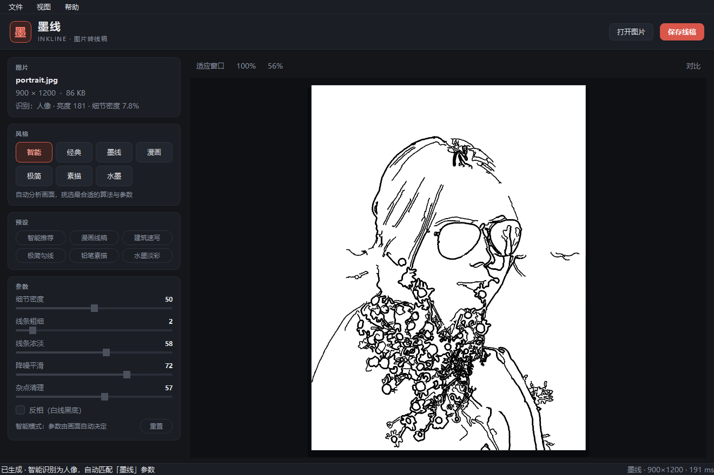
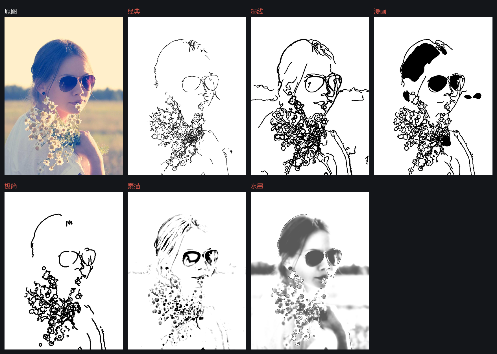
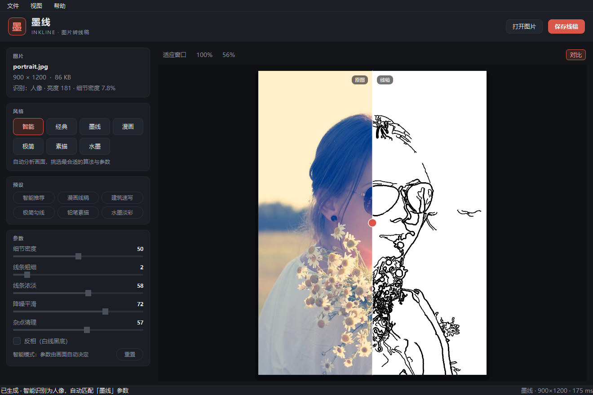

# 墨线 InkLine

> 把照片变成手绘线稿的桌面工具 —— 打开图片，挑一个风格，导出。

墨线是一个用 Python + PySide6 + OpenCV 写的图片转线稿工具。它不靠死板的固定阈值，而是先「读懂」这张照片（人像 / 风景 / 复杂场景、亮度、对比度、细节密度），再据此自动挑选算法与参数；你也可以随时手动接管线宽、浓淡、降噪。



## 七种风格，一张图看全



| 风格 | 说明 |
| --- | --- |
| 智能 | 自动分析画面，挑选最合适的算法与参数 |
| 经典 | **原版算法**：Canny 边缘检测 + 反相 + 腐蚀加粗，线条细利落 |
| 墨线 | 多尺度勾线，线条干净、细节完整（默认推荐） |
| 漫画 | 粗勾线加实心黑块，氛围感强 |
| 极简 | 只留主体轮廓，干净利落 |
| 素描 | 保留明暗调子，像铅笔手绘 |
| 水墨 | 柔和的淡墨块面，留白自然 |

右键？不需要。左侧一列参数随时可调，右侧画布上按住 **对比** 就能左右拖动分隔线，看原图和线稿的差别：



## 特性

- **经典模式**：1.0 之前的原版算法（Canny 100/200 + 反相 + 腐蚀调粗细）原样保留，按原图分辨率计算，所见即所得。
- **智能模式**：分析照片的题材、亮度、对比度与细节密度，自动决定算法和参数；拖动任一滑块即刻转为手动微调。
- **线条密度锁定**：按梯度分位数迭代求解 Canny 阈值，让「墨迹占画面的百分比」稳定可控，同一套参数在不同照片上不会一边糊一边空。
- **纹理抑制**：细节过密的画面（树叶、砂砾、毛皮）自动收敛，避免画成一团黑。
- **多尺度勾线**：粗尺度主轮廓加粗、细尺度补充细节，接近手绘的「外粗内细」。
- **预览与导出一致**：预览按窗口缩放渲染，导出按原图分辨率重算，所见即所得。
- **中文界面**：深色主题、拖放打开、快捷键齐全，支持中文路径与 PNG/JPG/WEBP/BMP/TIFF 输入。
- **反相**：一键切换白线黑底。

## 下载

到 [Releases](https://github.com/hemuandy/InkLine/releases) 下载 `InkLine.exe`，双击即可运行（Windows 10/11，64 位，免安装）。

> 首次启动会有几秒解压时间；单文件包约 100 MB（PySide6 + OpenCV 的体积）。

## 从源码运行

```bash
git clone https://github.com/hemuandy/InkLine.git
cd InkLine
pip install -r requirements.txt
python main.py
```

需要 Python 3.9+。

## 使用

1. `Ctrl+O` 或把图片拖进窗口；
2. 左侧选风格 / 预设，或用滑块微调；
3. `Ctrl+S` 导出线稿（默认同名 PNG）。

| 快捷键 | 功能 |
| --- | --- |
| `Ctrl+O` | 打开图片 |
| `Ctrl+S` | 保存线稿 |
| `Ctrl+0` | 适应窗口 |
| `Ctrl+1` | 100% 显示 |
| `C` | 对比模式 |
| `I` | 反相 |

## 算法是怎么变「聪明」的

1. **分析**（`inkline/core/analyzer.py`）：缩小取样，统计亮度、对比度、边缘密度与人脸特征，判定题材并给出初始参数。
2. **预处理**：转灰度 → CLAHE 局部对比度 → 双边滤波（保边降噪）→ 自动色阶。
3. **勾线**（`inkline/core/renderer.py`）：对梯度幅值取分位数得到初始阈值，再按「实际墨迹占比」迭代逼近目标密度；同时给一个由 99 分位梯度决定的强度下限，宁可少画也不把噪点画成线。
4. **主轮廓**：粗尺度结果膨胀一档后与细尺度取最大值，形成主次分明的线条层次。
5. **收尾**：按面积与连通性清掉孤立杂点，按粗细参数膨胀，反相。

实测 900×1200 的照片约 0.2 秒出图，4000 万像素约 2 秒。

## 项目结构

```
InkLine/
├── main.py                 # 入口
├── inkline/
│   ├── app.py              # QApplication 装配
│   ├── imageio.py          # 中文路径安全的读写
│   ├── core/
│   │   ├── params.py       # 参数模型 / 风格 / 预设
│   │   ├── analyzer.py     # 画面分析与自动参数
│   │   └── renderer.py     # 六种渲染算法
│   ├── ui/
│   │   ├── main_window.py  # 主界面
│   │   ├── widgets.py      # 卡片、滑块、画布
│   │   ├── workers.py      # 后台渲染队列
│   │   └── theme.py        # 深色主题样式
│   └── assets/             # 图标
├── scripts/                # 图标 / 截图 / 文档图 / 版本信息
└── InkLine.spec            # PyInstaller 打包配置
```

## 自己打包

```bash
pip install pyinstaller
python -m PyInstaller InkLine.spec --noconfirm --clean
# 产物：dist/InkLine.exe
```

## 许可证

[MIT](LICENSE)
